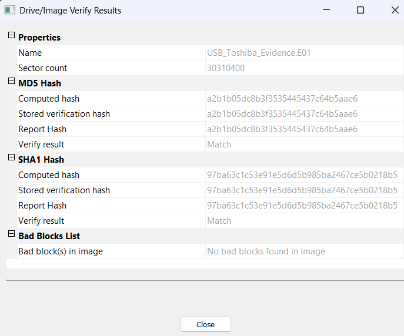
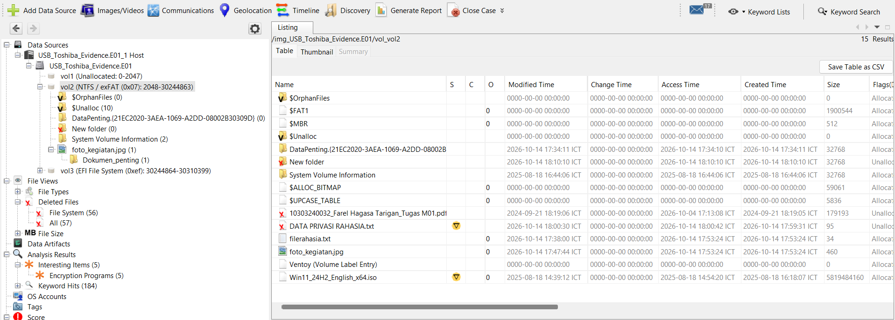
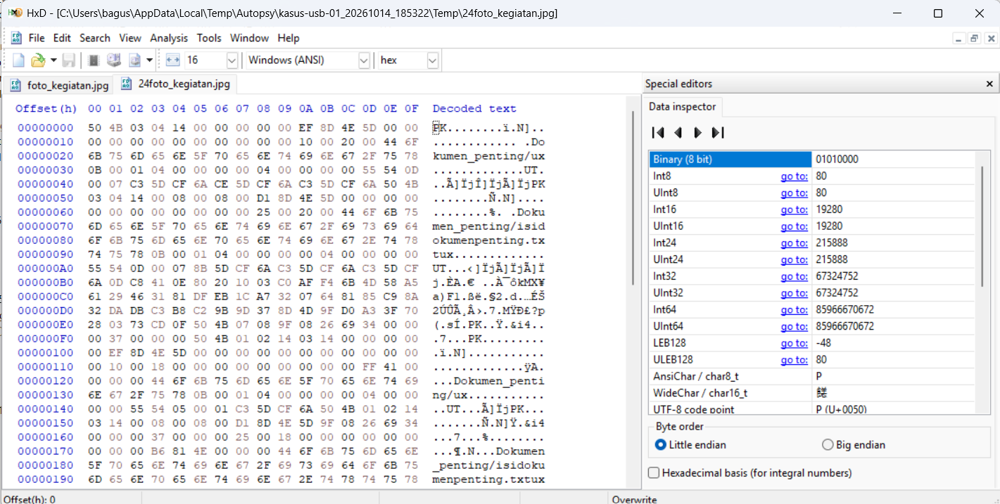
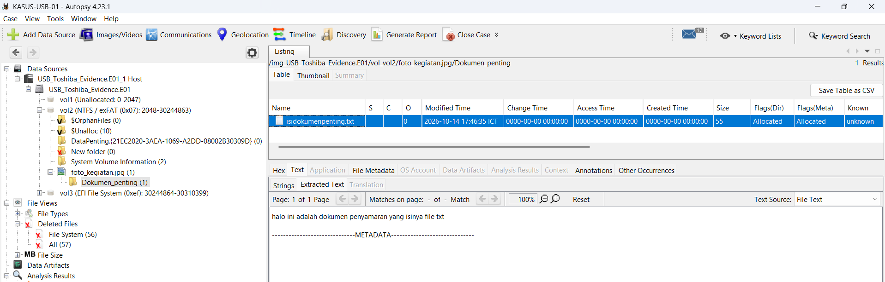
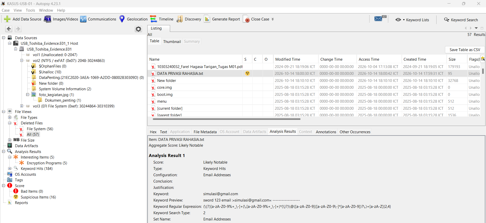
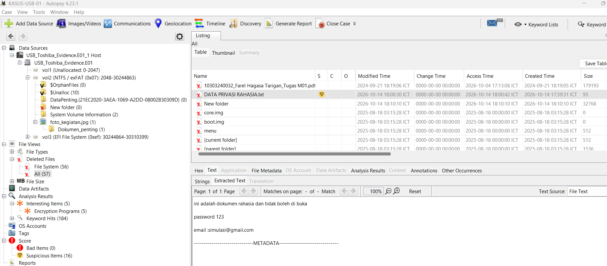

# 🔍 Digital Forensics Examination: Physical USB Investigation

[](./Digital%20Forensics%20Examination%20Report.pdf)
[](./Digital%20Forensics%20Examination%20Report.pdf)
[](./artifacts/hashes.txt)
[](./scripts/)
[](https://github.com/bagusa13)

Investigasi forensik digital komprehensif terhadap media penyimpanan fisik USB flash drive untuk membuktikan integritas rantai bukti (*chain-of-custody*), memetakan tata letak partisi Master Boot Record (MBR), merekonstruksi berkas terhapus dari *unallocated space* (*data carving*), serta menganalisis taktik penyamaran anti-forensik (*file extension spoofing* dan *Windows CLSID directory camouflage*).

📄 **[Unduh Laporan Formal Forensik (PDF)](./Digital%20Forensics%20Examination%20Report.pdf)** | 📊 **[Slide Acuan Materi Dosen](./documentation/USB_Forensics_Flow.pptx)**

---

## 📋 1. Ringkasan Kasus & Parameter Bukti (Case Overview)

* **Identifikasi Kasus:** `KASUS-USB-01`
* **Identifikasi Bukti:** `EVD-USB-01`
* **Model Perangkat Asli:** TOSHIBA TransMemory USB Device (Removable Media)
* **Nomor Seri Perangkat:** `0C`
* **Kapasitas Fisik / Labeled:** 16 GB (~14.45 GiB / 15,518,924,800 bytes)
* **Jumlah Sektor Fisik:** 30,310,400 sektor (512 bytes per sektor)
* **Geometri Drive:** 1,886 Cylinders, 255 Tracks/Cylinder, 63 Sectors/Track
* **Citra Forensik Bukti:** `USB_Toshiba_Evidence.E01` (Expert Witness Format)

### Verifikasi Integritas Kriptografis (Dual-Hash Verification)
Akuisisi bukti fisik dilakukan secara *bit-stream physical imaging* menggunakan mode proteksi baca (*software read-only*). Integritas citra forensik terbukti identik tanpa perubahan bit tunggal (0 *bad sectors*):

| Algoritma | Stored Acquisition Hash | Computed Verification Hash | Status Integritas |
| :--- | :--- | :--- | :--- |
| **MD5** | `a2b1b05dc8b3f3535445437c64b5aae6` | `a2b1b05dc8b3f3535445437c64b5aae6` | **VERIFIED / MATCH** |
| **SHA-1** | `97ba63c1c53e91e5d6d5b985ba2467ce5b0218b5` | `97ba63c1c53e91e5d6d5b985ba2467ce5b0218b5` | **VERIFIED / MATCH** |



---

## 🛠️ 2. Metodologi & Forensic Toolkit

1. **FTK Imager (v8.3.0.27)**: Akuisisi citra fisik bit-stream, kompresi container E01 level 6, dan validasi *dual-hashing* integritas.
2. **Autopsy Forensic Browser (v4.23.1)**: Parsing sistem berkas MBR/exFAT, analisis *unallocated space*, ekstraksi *embedded containers*, dan pencarian kata kunci (*keyword hits indexing*).
3. **HxD Hex Editor (v2.5.0.0)**: Inspeksi biner mentah sektor *low-level*, verifikasi *magic bytes*, dan deteksi anomali struktur berkas.
4. **Python Custom Scripts (v3.10+)**: Otomasi verifikasi hash bukti, pemindai *file signature mismatch*, dan detektor penyamaran direktori CLSID.

---

## 🗂️ 3. Arsitektur Partisi & Tata Letak Sistem Berkas

Pemeriksaan struktur partisi berbasis Master Boot Record (MBR) mengidentifikasi 3 volume regional:

| Volume | Tipe / Sistem Berkas | Rentang Sektor | Ukuran | Label Volume | Deskripsi |
| :--- | :--- | :--- | :--- | :--- | :--- |
| **Volume 1** | Unallocated | 0 – 2,047 | ~1 MB | *N/A* | Berisi MBR Sector 0, executable boot code, dan partition alignment slack. |
| **Volume 2** | exFAT | 2,048 – 30,244,863 | ~14.42 GiB | `Ventoy` | Partisi data pengguna aktif dan area penyamaran bukti. |
| **Volume 3** | FAT (EFI) | 30,244,864 – 30,310,399 | 32 MB | `VTOYEFI` | Partisi bootloader sistem Ventoy EFI. |



---

## 🚨 4. Temuan Forensik Utama & Analisis Anti-Forensik

### 📌 Temuan 1: Manipulasi Ekstensi Berkas (*File Extension Spoofing*)
* **Artefak Target:** `foto_kegiatan.jpg` (Ukuran: 460 Bytes).
* **Anomali Header:** Berkas diberi ekstensi `.jpg` agar tersamar sebagai citra foto biasa. Namun, inspeksi heksadesimal pada *offset* `0x00` menunjukkan *magic signature* **`50 4B 03 04` (`PK..`)**, yang merupakan penanda valid arsip terkompresi **ZIP**.
* **Analisis Heksadesimal (HxD):**



* **Hasil Ekstraksi Payload (Autopsy Embedded Extractor):**
  Modul ekstraksi berhasil mengekstrak hierarki internal kontainer yang berisi direktori `Dokumen_penting/isidokumenpenting.txt` (55 bytes). Teks ASCII yang berhasil didekode:
  ```text
  halo ini adalah dokumen penyamaran yang isinya file txt
  ```



---

### 📌 Temuan 2: Penyamaran Direktori Windows CLSID (*Shell Namespace Camouflage*)
* **Artefak Target:** Direktori bernama `DataPenting.{21EC2020-3AEA-1069-A2DD-08002B30309D}`.
* **Taktik Anti-Forensik:** Pemilik perangkat memanfaatkan Windows Shell Class ID (CLSID) `{21EC2020-3AEA-1069-A2DD-08002B30309D}` (*All Control Panel Tasks / GodMode applet*). 
* **Dampak pada GUI Windows:** Dalam Windows Explorer biasa, folder ini berubah wujud menjadi ikon *Control Panel* dan mengalihkan klik pengguna ke panel pengaturan Windows, sehingga menyembunyikan berkas dari pengguna non-teknis.
* **Mitigasi Forensik:** Software forensik (Autopsy & FTK Imager) membaca *directory entry table* langsung di level sistem berkas exFAT tanpa bergantung pada API Explorer shell Windows, sehingga isi direktori tetap terbaca secara transparan.

---

### 📌 Temuan 3: Rekonstruksi Berkas Terhapus & Ekstraksi Kredensial
* **Rekonstruksi Direktori:** Autopsy merekonstruksi folder yang telah dihapus bernama `New folder` dari tabel direktori exFAT (status *orphan/deleted*).
* **Carving Berkas Sensitif:** Ditemukan berkas terhapus bernama `DATA PRIVASI RAHASIA.txt` (95 bytes, MD5: `b8e74eabcc23c85531d7ac6d2a84ecd9`).



* **Ekstraksi Kredensial (Keyword Search Hits):**
  Pencarian string otomatis mengonfirmasi adanya kebocoran kredensial dalam berkas terhapus tersebut:
  ```text
  ini adalah dokumen rahasia dan tidak boleh di buka
  password 123
  email simulasi@gmail.com
  ```



---

## ⏱️ 5. Garis Waktu Rekonstruksi Aktivitas (Timeline)

| Waktu (UTC+7 / ICT) | Tipe Kejadian | Deskripsi Aktivitas Pengguna |
| :--- | :--- | :--- |
| **17:46:35** | Pembuatan Berkas | Payload `isidokumenpenting.txt` dibuat dan dikompresi ke arsip ZIP. |
| **17:47:44** | Anti-Forensics | Arsip ZIP diubah namanya secara manual menjadi `foto_kegiatan.jpg`. |
| **17:59:31** | Pembuatan Berkas | Berkas kredensial sensitif `DATA PRIVASI RAHASIA.txt` dibuat pada flashdisk. |
| **18:00:42** | Penghapusan Berkas | Berkas `DATA PRIVASI RAHASIA.txt` dihapus oleh pengguna (status dialihkan ke unallocated). |
| **18:30:20 – 18:38:24** | Akuisisi Forensik | Pemeriksa forensik melakukan *bit-stream imaging* dan verifikasi hash tanpa eror. |

---

## 💻 6. Perkakas Otomasi Forensik (Python Scripts)

Repositori ini menyertakan script Python yang dapat direproduksi (*reproducible*) untuk menganalisis kasus serupa:

### 1. `scripts/file_signature_carver.py`
Mendeteksi ketidakcocokan antara ekstensi berkas dengan *magic bytes* mentah serta mengekstrak kontainer tersembunyi:
```bash
python scripts/file_signature_carver.py artifacts/foto_kegiatan.jpg --extract-to ./carved_output
```
*Output:*
```text
File      : foto_kegiatan.jpg
Header    : 50 4B 03 04 14 00 00 00
Declared  : .jpg
Detected  : ZIP/Archive
Verdict   : [!] MISMATCH DETECTED (SPOOFED)
[+] Carving embedded ZIP entries from: artifacts/foto_kegiatan.jpg
    -> Extracted: Dokumen_penting/isidokumenpenting.txt (55 bytes)
```

### 2. `scripts/evidence_verifier.py`
Memvalidasi integritas citra forensik bit-stream dengan membandingkan nilai hash terhadap baseline log akuisisi:
```bash
python scripts/evidence_verifier.py /path/to/USB_Toshiba_Evidence.E01
```

### 3. `scripts/clsid_detector.py`
Memindai direktori atau volume flashdisk untuk mendeteksi taktik kamuflase Windows CLSID:
```bash
python scripts/clsid_detector.py /path/to/mounted_volume
```

---

## 📂 7. Struktur Repositori

```text
dfir-usb-investigation/
|-- assets/                            # Bukti Tangkapan Layar Forensik Resmi (FTK, Autopsy, HxD)
|   |-- 01-ftk-drive-identification.png
|   |-- 02-ftk-acquisition-setup.png
|   |-- 03-ftk-hash-verification.png
|   |-- 04-autopsy-partition-filesystem-inventory.png
|   |-- 05-autopsy-deleted-directory-recovery.png
|   |-- 06-autopsy-deleted-credential-file.png
|   |-- 07-autopsy-keyword-search-evidence.png
|   |-- 08-autopsy-embedded-extractor-payload.png
|   `-- 09-hxd-hex-magic-bytes-spoofing.png
|-- artifacts/                         # Sampel Bukti Asli, Hash, & Log Akuisisi
|   |-- acquisition_log.txt            # Log resmi FTK Imager 8.3.0.27
|   |-- extracted_payload_sample.txt   # Dekode payload rahasia & kredensial
|   |-- foto_kegiatan.jpg              # Sampel bukti spoofed ZIP 460-byte
|   `-- hashes.txt                     # Rekap nilai MD5 & SHA-1
|-- documentation/                     # Berkas Pendukung & Presentasi
|   `-- USB_Forensics_Flow.pptx        # Slide alur kerja investigasi forensik
|-- scripts/                           # Perkakas Analisis Forensik Python
|   |-- clsid_detector.py              # Detektor kamuflase Windows CLSID
|   |-- evidence_verifier.py           # Verifikator dual-hash integritas bukti
|   `-- file_signature_carver.py       # Carver & scanner ekstensi berkas palsu
|-- Digital Forensics Examination Report.pdf # Dokumen Laporan Forensik Formal
`-- README.md                          # Dokumentasi Utama Portofolio
```

---

## 👤 Pemeriksa Forensik & Kontak

- **Pemeriksa:** Mohammad Bagus Satrio
- **Email:** [bagusa1313@gmail.com](mailto:bagusa1313@gmail.com)
- **GitHub:** [@bagusa13](https://github.com/bagusa13)
- **LinkedIn:** [linkedin.com/in/bagusa](https://www.linkedin.com/in/bagusa)
- **Lisensi Portofolio:** [MIT License](LICENSE)
